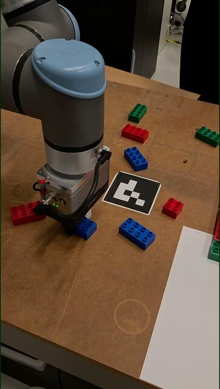
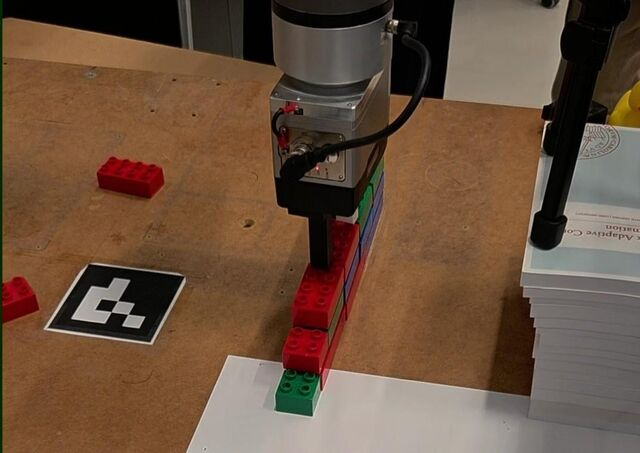

# Building a Duplo wall with a UR10e

For the FRTN85 Applied Robotics course at Lund University, our team built a robot that turns a pile of loose Duplo bricks into a wall. A RealSense D435i camera locates the bricks, and a UR10e arm picks them up, aligns them, and stacks them according to a wall plan.

## Physical demonstration

| Approaching the bricks | Placing a brick | Final wall |
| :---: | :---: | :---: |
|  |  |  |

*Photos from Group 8’s FRTN85 Applied Robotics presentation at Lund University.*

## How it works

1. **Locate the bricks.** OpenCV uses color, contours, and studs to estimate each brick’s size and orientation. ArUco calibration maps camera measurements into the robot’s coordinate system.
2. **Plan the wall.** A greedy planner sorts the available bricks by length and assigns them positions across three layers.
3. **Align and stack.** MoveIt 2 plans the arm motions. The gripper picks up each brick, aligns it, then grasps it again for placement. Small alignment errors can accumulate as the wall grows.

## Code and setup

- [ROS 2 package](ros2_ws/src/lego_stacking/) · [Brick detection](ros2_ws/src/lego_stacking/lego_stacking/new_vision.py) · [Wall assembly](ros2_ws/src/lego_stacking/lego_stacking/final_wall.py)
- [Installation](INSTALL.md) · [Lab execution guide](EXECUTE.md) · [Camera calibration notes](docs/presentation-calibration-opencv.md)

Some planner commands listed in `setup.py` reference modules absent from this snapshot.

[Group 8 contributors](docs/gitlab-source/README.md) · [Original LTH GitLab project](https://gitlab.control.lth.se/regler/frtn85-frtn80-applied-robotics/projects-ht2026/group-08)
