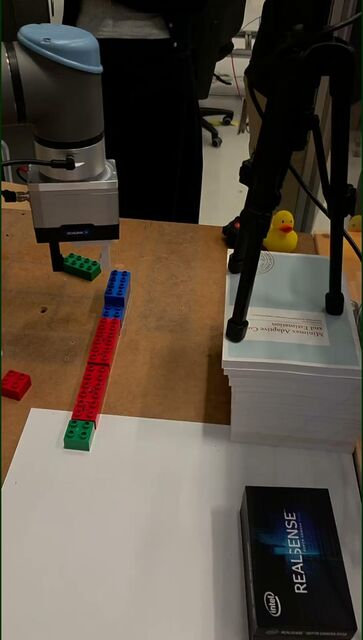

# Applied Robots · UR10e LEGO stacking

Course project workspace for ROS 2 Jazzy, MoveIt 2, a UR10e, and a RealSense D435i. The Group 08 `lego_stacking` ROS package has been imported from the uploaded GitLab source archive.

## Physical demonstration

The UR10e uses camera measurements to locate Duplo bricks, then picks them up and places them in rows to build a wall.

| Approaching the bricks | Placing a brick | Final wall |
| :---: | :---: | :---: |
|  |  |  |

*Photos from Group 8’s FRTN85 Applied Robotics presentation at Lund University.*

## Start here

1. Follow [docs/setup-wsl.md](docs/setup-wsl.md) on your own Windows/WSL Ubuntu 24.04 machine.
2. Follow [docs/work-session.md](docs/work-session.md) to run the simulator, driver, planner, camera, and project code.
3. See [INSTALL.md](INSTALL.md) and [EXECUTE.md](EXECUTE.md) for the imported project instructions. The source package is in [ros2_ws/src/lego_stacking/](ros2_ws/src/lego_stacking/).

## Layout

| Path | Purpose |
| --- | --- |
| `docs/` | Local setup, workflow, and source links |
| `course-materials/teacher/` | Original teacher instructions |
| `course-materials/robotstudio-abb/` | Earlier ABB RobotStudio course references; separate from UR10e setup |
| `ros2_ws/src/` | Imported Group 08 ROS package source |

The UR10e setup uses ROS 2. The ABB RobotStudio PDFs are included only as course references; RobotStudio is not an installation prerequisite for this project. Do not commit passwords, robot credentials, camera recordings, or calibration files containing private lab details.

## Status

- [x] Repository skeleton and source documents organized
- [ ] Ubuntu 24.04 / ROS 2 Jazzy installed on Olivia's computer
- [ ] MoveIt, UR driver, simulator, RealSense, OpenCV verified there
- [x] Group 08 project package imported from GitLab archive
- [ ] Simulator session verified
- [ ] Real robot procedure obtained from Sebastiano

## References

- [ROS 2 Jazzy installation](https://docs.ros.org/en/jazzy/Installation/Ubuntu-Install-Debs.html)
- [MoveIt 2](https://moveit.picknik.ai/main/index.html)
- [Universal Robots ROS 2 driver](https://github.com/UniversalRobots/Universal_Robots_ROS2_Driver)
- [RealSense ROS wrapper](https://github.com/realsenseai/realsense-ros)
- [librealsense](https://github.com/realsenseai/librealsense)
- [OpenCV](https://github.com/opencv/opencv)

## Presentation: calibration and OpenCV

See the [presentation guide](docs/presentation-calibration-opencv.md) for the verified ArUco/depth/SVD calibration procedure, the detection-to-motion interface, a five-slide outline and speaking notes. It is based on the uploaded GitLab archive plus camera_real_test.py and final_wall.py. The uploaded source now includes `new_vision.py`; the older presentation notes predate this import. Robot execution and the runtime calibration connection have not been verified here.

## Imported source and credits

Source: [LTH GitLab Group 08](https://gitlab.control.lth.se/regler/frtn85-frtn80-applied-robotics/projects-ht2026/group-08), archive commit `cbd06c030ef5e1a17604df9746695f6dabca4fa9` (29 October 2026). Original group credits and Git configuration are preserved in [docs/gitlab-source/](docs/gitlab-source/).

The package was imported without code changes. Its `setup.py` lists planner entry points whose modules are absent from the supplied archive; this import does not establish that the package builds or runs on the robot.
